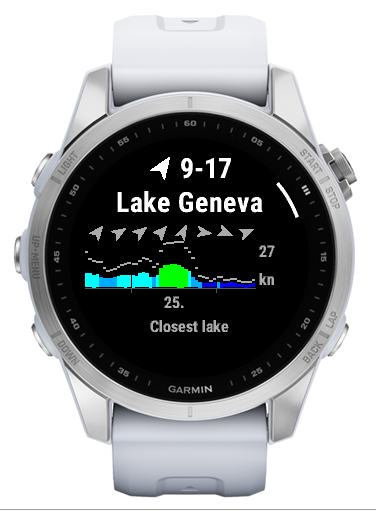
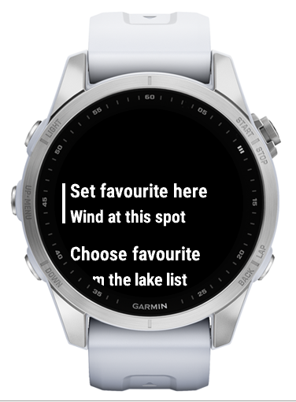

# LakeWind 

LakeWind is a Garmin glance app that shows the wind on about 90 Swiss and alpine lakes, for sailors, windsurfers, kiters, SUP paddlers and swimmers. The wind comes from the free [Open-Meteo API](https://open-meteo.com/), the lakes and their borders are the ones of [TwelveLakes](https://github.com/Wandersalamander/TwelveLakes).

  

## Features

- **Glance:** your favourite lake, a Beaufort color bar with the current wind on it, and the wind as `<mean>-<gust> kn` with an arrow pointing where the wind blows.
- **View:** the current wind at your favourite lake, a 48 hour forecast chart and the wind at the lake closest to you, with its distance.
- **Forecast chart:** one bar per hour, colored by wind speed. Light gray marks show the gusts, the arrows above the bars the wind direction every 6 hours.
- **Knots or km/h:** knots by default, km/h can be chosen in the app settings in Garmin Connect or Garmin Express.
- **No API key** needed.

### Colors

| Color | Wind | Beaufort |
|---|---|---|
| dark blue | below 3 kn (6 km/h) | 0-1, calm |
| blue | 3-6 kn (6-12 km/h) | 2, light breeze |
| cyan | 6-11 kn (12-20 km/h) | 3, gentle breeze |
| green | 11-16 kn (20-29 km/h) | 4, moderate breeze, good sailing wind |
| yellow | 16-21 kn (29-39 km/h) | 5, fresh breeze |
| red | from 21 kn (39 km/h) | 6+, strong breeze |

Monochrome watches (Instinct) draw everything in white.

## Usage

1. Open LakeWind on your watch. It loads the wind of your favourite lake (Lake Geneva at first) and of the lake closest to you.
2. To change your favourite, press START and choose:
   - **Set favourite here**, while standing at the lake. The wind is then always taken at the spot where you stood.
   - **Choose favourite**, to pick a lake from the list with UP and DOWN. The wind is then taken in the middle of the lake.

The arrows point north up, they do not turn with the watch.

## API

The glance and the closest lake ask for the current wind only:

```
https://api.open-meteo.com/v1/forecast?latitude=46.28708&longitude=6.16961&current=wind_speed_10m,wind_gusts_10m,wind_direction_10m&timeformat=unixtime
```

The view adds the hourly forecast with `&hourly=wind_speed_10m,wind_gusts_10m,wind_direction_10m&forecast_hours=48`, starting at the current hour.
The app always requests km/h and converts for display, so a changed unit shows without a new request.
Times are requested as unix times, which are smaller to parse and store on the watch than ISO times.
All wind values are 10 m above ground, from the Open-Meteo `best_match` model. `scripts/check_api_contract.sh` checks the response for every lake and runs daily in CI.

## Building

Requirements: [Connect IQ SDK](https://developer.garmin.com/connect-iq/sdk/) or Docker.

```
bash scripts/build_iq.sh <developer_key.der>
```

This creates `bin/LakeWind.iq` for every device in `manifest.xml` with the toolchain pinned in `scripts/toolchain.env`, the same one CI uses, and fails on compiler warnings.
It uses Docker if it's installed, natively or in WSL. Otherwise the locally installed SDK must match the pinned version exactly.
With Docker it then updates the screenshots, see `scripts/screenshots.sh`.

Unit tests run in the simulator of the same image:

```
source scripts/toolchain.env && docker run --rm -v "$PWD:/app" -w /app "$CONNECTIQ_IMAGE" fenix7pro
```

To sideload, build a `.prg` for your watch and copy it to `GARMIN/APPS/`.

## Lakes

The lake borders in `scripts/lake_borders.json` come from Alplakes. After changing them, regenerate the resources with `python scripts/generate_lake_resources.py`.

## Acknowledgements

- Weather data by [Open-Meteo.com](https://open-meteo.com/), licensed under [CC BY 4.0](https://creativecommons.org/licenses/by/4.0/).
- Lake borders by the [Alplakes](https://www.alplakes.eawag.ch/) team.
- Based on [TwelveLakes](https://github.com/Wandersalamander/TwelveLakes).
