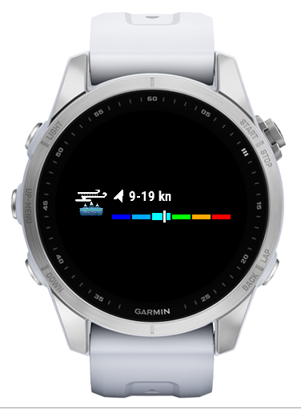
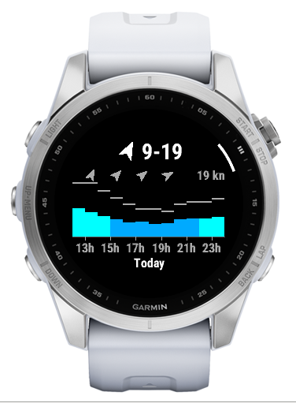
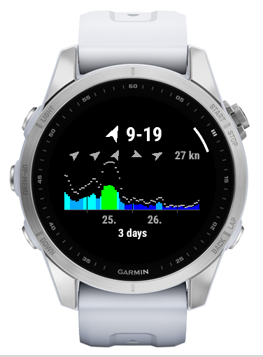

# LakeWind 

LakeWind is a Garmin glance app that shows the wind at your favourite spot or where you are, anywhere in the world, for sailors, windsurfers, kiters, SUP paddlers and swimmers. The wind comes from the free [Open-Meteo API](https://open-meteo.com/).

 

  

## Features

- **Glance:** the current wind as `<mean>-<gust> kn` with an arrow pointing where the wind blows, and a Beaufort color bar with the wind on it.
- **View:** the current wind and a forecast chart.
- **Favourite or GPS position:** the menu switches between the wind at your favourite spot and the wind where you are.
- **Three forecast pages**, switched with DOWN and UP or by swiping: the next 3 hours in quarter hours, the rest of today and the next 3 days in hours. The title of the page shows right of the chart.
- **Forecast chart:** bars colored by wind speed, light gray marks for the gusts and arrows above the bars for the wind direction.
- **Knots or km/h:** knots by default, km/h can be chosen in the app settings in Garmin Connect or Garmin Express.
- **No API key** needed.

### Colors

| Color | Wind | Beaufort |
|---|---|---|
| dark blue | below 3 kn (6 km/h) | 0-1, calm |
| blue | 3-6 kn (6-12 km/h) | 2, light breeze |
| cyan | 6-11 kn (12-20 km/h) | 3, gentle breeze |
| green | 11-16 kn (20-29 km/h) | 4, moderate breeze, good sailing wind |
| yellow | 16-21 kn (29-39 km/h) | 5, fresh breeze |
| red | from 21 kn (39 km/h) | 6+, strong breeze |

Monochrome watches (Instinct) draw everything in white.

## Usage

1. Open LakeWind on your watch. It shows the wind at your favourite spot, at first the Club Nautique de Versoix on Lake Geneva.
2. Press START for the menu:
   - **Set favourite here** saves where you stand as your favourite spot.
   - **Show** switches between **Favourite** and **GPS position**. With GPS position, the view follows you with GPS while it is open. The glance gets no GPS of its own and shows the last position the view got.
   - **Reload** asks for new data right away.

The arrows point north up, they do not turn with the watch.

## API

The glance asks for the current wind only:

```
https://api.open-meteo.com/v1/forecast?latitude=46.29&longitude=6.17&current=wind_speed_10m,wind_gusts_10m,wind_direction_10m&timeformat=unixtime
```

The view adds the hourly forecast with `&hourly=wind_speed_10m,wind_gusts_10m,wind_direction_10m&forecast_hours=72` and the quarter hourly one with `&minutely_15=...&forecast_minutely_15=12`, both starting now. The "today" page is cut from the hourly forecast.
Positions are rounded to 2 decimals, about 1 km, which is finer than the weather models. The data is stored per rounded position, so switching between favourite and GPS never shows the wind of the other place, and GPS jitter asks for nothing new.
Each kind of request is sent at most every 15 minutes per position, as often as Open-Meteo updates the current wind. Only a new position or Reload in the menu ask earlier.
The app always requests km/h and converts for display, so a changed unit shows without a new request.
Times are requested as unix times, which are smaller to parse and store on the watch than ISO times.
All wind values are 10 m above ground, from the Open-Meteo `best_match` model. `scripts/check_api_contract.sh` checks the response at spots around the world and runs daily in CI.

## Building

Requirements: [Connect IQ SDK](https://developer.garmin.com/connect-iq/sdk/) or Docker.

```
bash scripts/build_iq.sh <developer_key.der>
```

This creates `bin/LakeWind.iq` for every device in `manifest.xml` with the toolchain pinned in `scripts/toolchain.env`, the same one CI uses, and fails on compiler warnings.
It uses Docker if it's installed, natively or in WSL. Otherwise the locally installed SDK must match the pinned version exactly.
With Docker it then updates the screenshots, see `scripts/screenshots.sh`.

Unit tests run in the simulator of the same image:

```
source scripts/toolchain.env && docker run --rm -v "$PWD:/app" -w /app "$CONNECTIQ_IMAGE" fenix7pro
```

To sideload, build a `.prg` for your watch and copy it to `GARMIN/APPS/`.

## Acknowledgements

- Weather data by [Open-Meteo.com](https://open-meteo.com/), licensed under [CC BY 4.0](https://creativecommons.org/licenses/by/4.0/).
- Based on [TwelveLakes](https://github.com/Wandersalamander/TwelveLakes).
